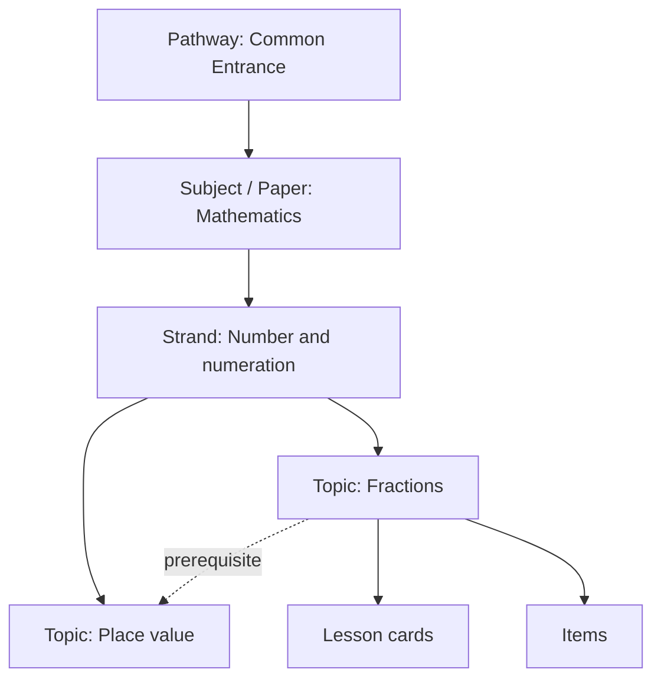
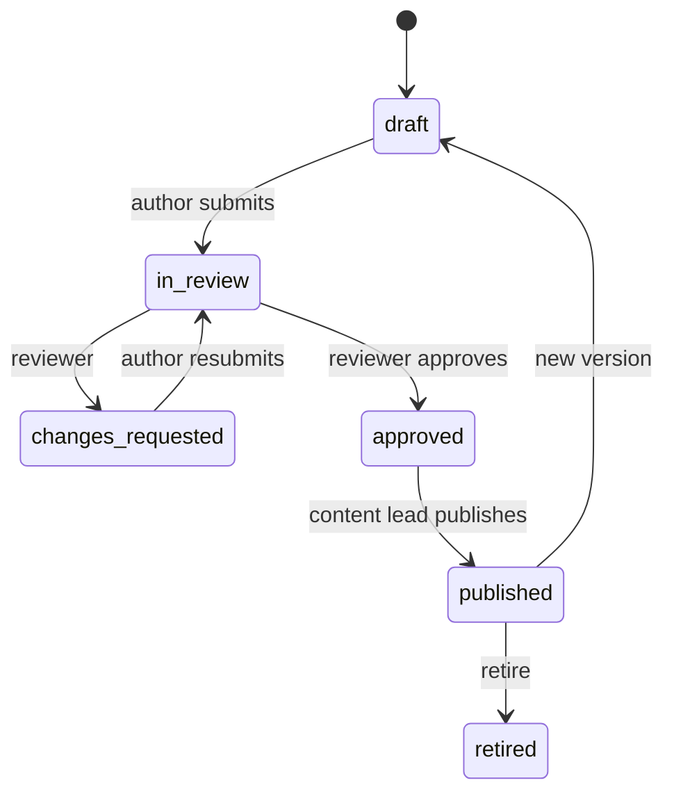

# 03 · Curriculum and content

## 1. Sources of truth

| Section | Curriculum | Notes |
|---|---|---|
| Common Entrance (MVP) | NECO NCEE syllabus and format for 2027 | **Verify papers, item counts, durations and mode (paper or CBT) against NECO's 2027 brochure** before blueprints are final. |
| Intermediate (Phase 2) | NERDC Basic Education Curriculum, Primary 1–6 | Track the revised curriculum rollout. Every curriculum node carries a `curriculum_edition` tag (`legacy` or `revised_2025`). |
| Early years (Phase 3) | National ECCDE curriculum and the National Policy on Education | Adult-led activities. Screen use follows WHO guidance: none under 2, at most 1 hour a day at ages 2–4. |

Exam names appear in plain text only. Stellara never uses exam-body logos, never claims affiliation, and never sells or promises "live questions" or "expo".

## 2. Curriculum graph

- `curriculum_nodes` is a tree: pathway → subject/paper → strand → topic.
- Prerequisites are a separate edge table, so a child can be sent back to the missing prerequisite.
- A topic can belong to several pathways (for example "Fractions" is used by both Intermediate P5 and Common Entrance), so mastery carries across sections.

## 3. Common Entrance coverage (MVP)

| Paper | Strands (draft) | Topic count target |
|---|---|---|
| Mathematics | Number and numeration; Fractions, decimals, percentages; Measurement; Geometry; Everyday statistics; Algebraic processes | ~22 |
| English | Comprehension; Vocabulary; Grammar and usage; Spelling and punctuation | ~16 |
| Quantitative Aptitude | Number patterns; Relationships and analogies; Missing numbers; Shape reasoning | ~10 |
| Verbal Aptitude | Analogies; Odd one out; Word relationships; Sequencing | ~10 |
| General Paper | Basic Science and Technology; Social and civic knowledge; Religious and moral education options | ~16 *(confirm structure with NECO 2027)* |

## 4. Content schema

### 4.1 Item

| Field | Type | Rule |
|---|---|---|
| `id` | uuid | Stable across versions |
| `version` | int | Increments on any published change |
| `topic_id` | uuid | Required |
| `type` | enum | `single_choice` · `multi_choice` · `numeric` · `ordering` · `match` · `cloze` |
| `stem` | rich text | Markdown subset plus maths (`$...$`, LaTeX) |
| `stimulus_id` | uuid, nullable | Shared passage or diagram for item groups |
| `options` | json | For choice types; 4 options by default |
| `answer` | json | Stored server-side only, never in client bundles |
| `explanation` | rich text | Worked solution, shown after the attempt |
| `hint` | rich text | One hint; showing it makes the response unscored |
| `difficulty` | enum | `easy` · `standard` · `hard` |
| `tags` | text[] | Includes `application`, `quick`, `calculator` |
| `curriculum_edition` | enum | `legacy` · `revised_2025` |
| `media` | json | Image references; **alt text required to publish** |
| `provenance` | enum | `original` · `licensed` · `public_domain` |
| `licence_ref` | text | Required when provenance is `licensed` |
| `author_id`, `reviewer_id` | uuid | Must be different people |
| `status` | enum | `draft` · `in_review` · `changes_requested` · `approved` · `published` · `retired` |
| `exposure_count` | int | Updated nightly; used to rotate items |
| `stats` | json | p-value, discrimination and median time, updated nightly once n ≥ 30 |

### 4.2 Stimulus

A shared passage, table or diagram used by 2–10 items (for example one comprehension passage with 5 questions). The fields are `id`, `version`, `kind`, `body`, `media`, `alt_text`, `provenance` and `licence_ref`.

### 4.3 Lesson card

A lesson is 3–6 cards and takes 5–8 minutes in total.

| Card kind | Purpose |
|---|---|
| `explain` | One idea, with a picture |
| `worked_example` | Step by step, with the steps revealed one at a time |
| `check` | One quick unscored question |
| `try_it` | 2–3 practice items (unscored inside the lesson) |
| `summary` | One-line takeaway from Auntie Stella |

### 4.4 Maths and media

- Maths is written in LaTeX and **rendered to HTML/MathML on publish** with KaTeX. The rendered output is stored, so no maths library ships to the child's device.
- Images are SVG where possible. Raster images are WebP at most 60 KB each, at most 640 px wide.
- No video in the MVP.

## 5. Volume targets for the MVP

| Asset | Target | Notes |
|---|---|---|
| Items per topic | 30 for mastery-critical topics, 20 elsewhere | Mastery needs unseen items for retention checks |
| Topics | ~74 | Across 5 papers |
| Total items | ~1,800–2,200 | Including placement and practice-test pools |
| Lessons | 1 per topic (~74) | Written with Auntie Stella's voice |
| Practice tests | 3 full forms | Assembled from a reserved pool not used in practice |
| Placement checks | 1 per paper | 20 items each |

Estimate for planning: about 1.5–3 hours per reviewed item including explanation, so roughly 3,000–6,000 hours. Get 2–3 real quotes before committing.

## 6. Workflow

Publishing checks, run in the content studio and again in the database:

1. Provenance is set; a licence reference is present if the item is licensed.
2. The reviewer is not the author.
3. The answer has been verified by the reviewer (a checkbox with their name and the time).
4. Alt text is present for every image.
5. Maths renders without errors.
6. Readability: English stems for P5–6 at or below the agreed grade level (checked automatically, with a manual override plus a reason).

## 7. People and rights

- Every author and reviewer signs an **IP assignment and originality warranty** before their first item.
- Past papers are **not** copied. Item formats may follow the exam style, but content must be original unless licensed in writing.
- A takedown process is published: one email address, acknowledgement within 2 working days, and removal of disputed items within 5 working days pending review.

## 8. Style guide for writers

- Use names, places and money from Nigerian life (₦, markets, buses, local foods), mixing regions and cultures. No stereotypes.
- One idea per stem. Avoid double negatives and trick questions.
- Distractors must reflect real misconceptions. Each wrong option gets a one-line "why someone might pick this" note for the explanation.
- Auntie Stella's lines follow [08 §10](08-design-system.md#10-voice-in-the-interface).
