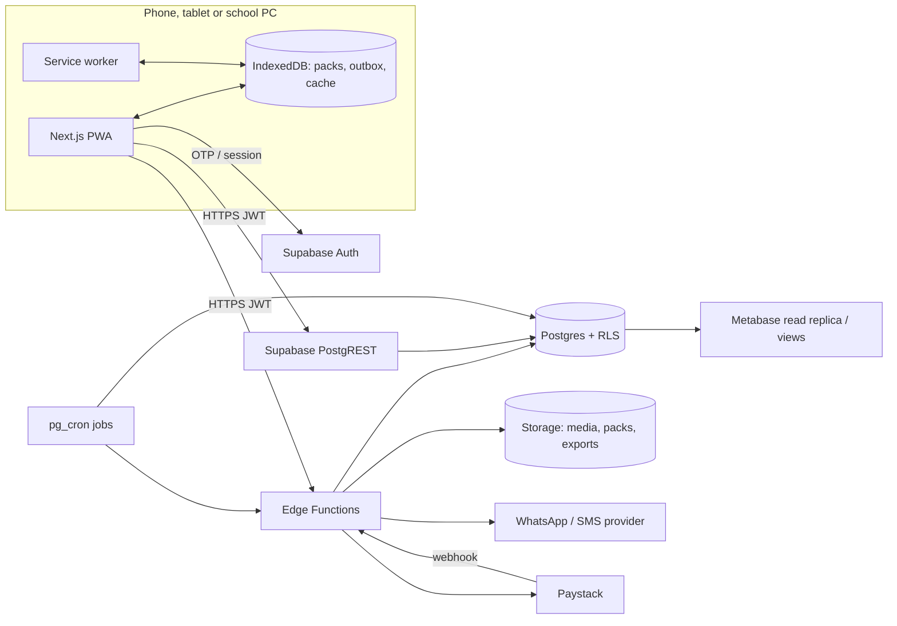
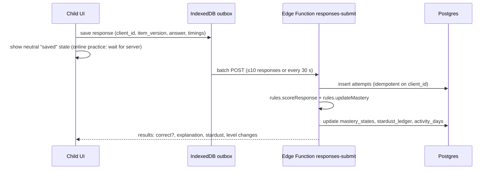

# 04 · Technical architecture

## 1. Summary

| Layer | Choice | Why |
|---|---|---|
| Client | **Next.js 15 (App Router), TypeScript, React**, installed as a **PWA** | One codebase for child, parent, teacher, school admin and content studio; largest local hiring pool |
| Offline | Service worker (Serwist), **IndexedDB via Dexie**, outbound sync queue | Interruptions and data costs are normal |
| Backend | **Supabase**: Postgres 15+, Row Level Security, Auth, Storage, Edge Functions (Deno), pg_cron, Realtime (teacher dashboard only) | Fast to start, Postgres underneath, RLS gives per-school isolation |
| Rules engine | `packages/rules`: pure TypeScript, no I/O | Same code in Edge Functions, the content studio and tests |
| Messaging | WhatsApp Business API through a Nigerian-friendly provider, SMS fallback (registered sender ID) | Parents live on WhatsApp |
| Payments | School licences invoiced (Paystack invoices or bank transfer). Parent add-on later through Paystack | B2B first |
| Hosting | Web on Vercel (or Cloudflare Pages); Supabase Pro in the nearest available region | See §8 on data location |
| Observability | Sentry (web and functions; PII scrubbing on), Supabase logs, uptime monitor | |
| Analytics | First-party `events` table plus Metabase. No third-party trackers on logged-in screens | Privacy for children |

## 2. System diagram



## 3. Repository layout

```
stellara/
  apps/
    web/                 Next.js app (child, parent, teacher, school, studio route groups)
  packages/
    rules/               Mastery, scoring, Stardust, streak, report rules + fixtures
    ui/                  Design-system components and tokens (see 08)
    content-schema/      Zod schemas for items, stimuli, lessons, blueprints
    i18n/                String catalogues (en first; yo, ha, ig ready)
  supabase/
    migrations/          SQL migrations (only way to change schema)
    functions/           Edge Functions (Deno)
    seed/                Seed data, fixtures, demo school
    tests/               pgTAP tests for RLS and constraints
  docs/                  This documentation
```

Tooling: pnpm workspaces and Turborepo, ESLint, Prettier, Vitest, Playwright, pgTAP, Lighthouse CI.

## 4. Apps and route groups

| Route group | Users | Auth |
|---|---|---|
| `/(child)` | Children | Child session token issued to a signed-in parent device or a class device (§6) |
| `/(family)` | Parents | Supabase Auth (phone OTP or email) |
| `/(teach)` | Teachers | Supabase Auth plus a school membership |
| `/(school)` | School admins | Supabase Auth plus the `school_admin` role |
| `/(studio)` | Authors and reviewers | Supabase Auth plus a content role; desktop only |
| `/(ops)` | Stellara staff | Supabase Auth plus the `ops` role, IP allow-list, MFA |
| `/basic/*` | Opera Mini and very old browsers | Server-rendered lessons and untimed practice only |

## 5. Data flow for a practice item



- **Online practice:** the UI waits for the server result (target p95 under 400 ms in Lagos). It shows the answer as "checking" with no correctness hint until then.
- **Offline pack with keys:** the UI gives instant feedback locally. The response is sent later with `key_on_device=true` and scored at low confidence ([02 §3.4](02-learning-rules.md#34-offline-evidence)).
- **Idempotency:** every response has a client-generated UUID (`client_id`), so a retry never double-counts.

## 6. Identity and sessions

- **Adults** use Supabase Auth: phone OTP (WhatsApp first, then SMS), or an email magic link. Staff roles require MFA (TOTP).
- **Children have no Supabase Auth user.** A child acts through a **child session**:
  - **Family device:** the parent is signed in. The child picks their profile and enters a 4-picture PIN. The Edge Function `child-session` returns a short-lived JWT (2 h, refreshable on the device for 30 days) with claims `{ role: 'child', child_id, guardian_id }`.
  - **School device:** the teacher starts "class mode" with a class code. The child picks their name and enters their picture PIN. The JWT has `{ role: 'child', child_id, class_id, school_id, mode: 'class' }` and expires at the end of the school day.
- PINs are stored as salted hashes (argon2id) in `child_pins`. Five wrong attempts lock the profile for 5 minutes.
- Shared phones: each child profile has its own IndexedDB partition, keyed by `child_id`.

## 7. Offline and sync

| Concern | Rule |
|---|---|
| What is cached | App shell, lesson cards for the current and next topics, up to 3 practice packs, the child's sky, the last report |
| Pack contents | 30–40 items plus explanations. Keys only in "practice packs", never in practice tests or review sets |
| Storage cap | 25 MB per device; least recently used packs are evicted |
| Outbox | Responses, lesson-complete events, set-complete events, each with `client_id` and `recorded_at` (device time) plus a `monotonic_offset` |
| Sync trigger | Online event, app foreground, every 30 s while online, and Background Sync where supported |
| Conflicts | The server wins for all scored state. The client never edits mastery, Stardust or streaks; it only shows what the server returns |
| Clock trust | Device time is used only to place a response in a learning day if the sync is within 72 h **and** the device clock differs from server time at sync by less than 10 minutes. Otherwise the server's receive time is used |
| Practice tests | Need a connection to start (to get the server timer). They then continue offline and follow the grace rules in [02 §5.2](02-learning-rules.md#52-timer-and-interruption-rules) |

## 8. Data location and transfer

- Supabase does not currently offer a region in Nigeria (check the current region list before setup). Choose the closest region with good latency to Lagos and Abuja, test from Nigerian networks, and record the choice in the decision log.
- Because children's data is stored outside Nigeria, the **DPIA must cover the cross-border transfer** and its legal basis (NDPA s.41–43). Parents see this in the consent notice.
- Media and packs are served through a CDN. Media contains no personal data.

## 9. Edge Functions (overview)

Full contracts are in [06 API and events](06-api-and-events.md).

| Function | Purpose |
|---|---|
| `consent-start`, `consent-confirm` | Record parental consent with verification |
| `child-create`, `child-session` | Create a child profile (after consent) and issue child JWTs |
| `class-join` | Link a child to a class with a class code |
| `set-start` | Assemble a practice or review set or topic assessment (no keys) |
| `responses-submit` | Batch responses → score → update mastery, Stardust and days |
| `test-start`, `test-resume`, `test-finish` | Practice-test sessions with the server timer |
| `pack-build` | Build an offline practice pack for a child |
| `report-weekly` | Scheduled: build parent reports and queue messages |
| `messages-dispatch` | Send WhatsApp or SMS through the provider, respecting quiet hours |
| `data-export`, `data-delete` | Fulfil data rights requests |
| `paystack-webhook` | Payment events (Phase 2 parent add-on; school invoices) |
| `content-publish` | Validate and publish items and lessons; render maths |

## 10. Scheduled jobs (pg_cron)

| Job | Schedule (Africa/Lagos) |
|---|---|
| Close learning day: streaks, clouds, outage excuses | Daily 03:05 |
| Due-review scheduling | Daily 03:15 |
| Item statistics and exposure counts | Daily 02:00 |
| Weekly parent reports | Sunday 18:00 |
| Finalise abandoned practice tests | Every 5 minutes |
| Retention purge (§[07](07-privacy-security-compliance.md#5-retention)) | Daily 01:00 |

## 11. Security model

- RLS is enabled on **every** table. There are no tables without policies. The service role is used only inside Edge Functions.
- Answer keys live in `item_answers`, readable only by the service role and content roles.
- Rate limits per child, device and IP on `responses-submit`, `child-session` and OTP endpoints.
- See [07](07-privacy-security-compliance.md) for the full control list.

## 12. Scale assumptions for the pilot

| Metric | Pilot (Jan–Apr 2027) | Year 1 |
|---|---|---|
| Schools | 5–10 | 50–100 |
| Active pupils | 1,000–2,000 | 15,000–30,000 |
| Responses per day (peak) | ~60,000 | ~1,000,000 |

A Supabase Pro instance with suitable compute handles the pilot comfortably. `attempts` is partitioned by month from day one.

## 13. Decisions (ADR summary)

| # | Decision | Status |
|---|---|---|
| ADR-001 | PWA first, no native app in the MVP | Accepted |
| ADR-002 | Supabase-first backend | Accepted (user decision, 12 Nov 2026) |
| ADR-003 | The server is the only authority for score, time, mastery, Stardust and streaks | Accepted |
| ADR-004 | Children have no auth user; child JWT issued by a function | Proposed |
| ADR-005 | First-party analytics only | Proposed |
| ADR-006 | Maths rendered at publish time with KaTeX | Proposed |
| ADR-007 | Hosting region and transfer basis | **Open**: DPO and engineering |
