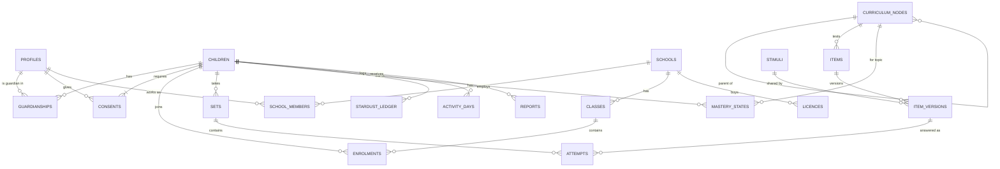

# 05 · Data model

Postgres on Supabase. All timestamps are `timestamptz` in UTC. Learning days are derived with the child's time zone (default `Africa/Lagos`) and the 03:00 boundary. Schema changes happen only through migrations in `supabase/migrations`.

## 1. Entity relationships

## 2. Tables

### People and access

| Table | Key columns | Notes |
|---|---|---|
| `profiles` | `id` (= auth.users.id), `display_name`, `phone`, `email`, `locale`, `created_at` | Adults only |
| `children` | `id`, `first_name`, `birth_year`, `avatar_key`, `timezone`, `exam_date` (nullable), `status` (`active` · `paused` · `deletion_pending`), `created_by` | **Constraint:** insert only via the `child-create` function, which checks for a valid consent |
| `guardianships` | `guardian_id`, `child_id`, `relationship`, `is_primary` | The primary guardian can manage consent |
| `consents` | `id`, `child_id` (nullable until the child is created), `guardian_id`, `notice_version`, `purposes` (jsonb), `method`, `verified_at`, `withdrawn_at`, `evidence_ref` | Append-only; withdrawal is a new state, not a delete |
| `child_pins` | `child_id`, `pin_hash`, `failed_count`, `locked_until` | Service role only |
| `devices` | `id`, `guardian_id` or `class_id`, `label`, `last_seen_at` | For session management and the "sign out everywhere" option |

### Schools

| Table | Key columns | Notes |
|---|---|---|
| `schools` | `id`, `name`, `state`, `lga`, `dpa_accepted_at`, `term_dates` (jsonb) | DPA = data processing agreement |
| `school_members` | `school_id`, `profile_id`, `role` (`school_admin` · `teacher`) | |
| `classes` | `id`, `school_id`, `name`, `level` (`P1`…`P6`, `KG1`…), `pathway_id`, `join_code`, `join_code_expires_at` | |
| `class_teachers` | `class_id`, `profile_id` | |
| `enrolments` | `class_id`, `child_id`, `enrolled_at`, `left_at` | |
| `licences` | `id`, `school_id`, `seats`, `starts_on`, `ends_on`, `invoice_ref` | |
| `assignments` | `id`, `class_id`, `kind`, `topic_ids`, `due_at`, `created_by` | |

### Curriculum and content

| Table | Key columns | Notes |
|---|---|---|
| `curriculum_nodes` | `id`, `parent_id`, `kind` (`pathway` · `subject` · `strand` · `topic`), `title`, `code`, `edition`, `sort` | |
| `node_prerequisites` | `node_id`, `requires_node_id` | |
| `pathway_topics` | `pathway_id`, `topic_id` | A topic may serve several pathways |
| `items` | `id`, `topic_id`, `current_version`, `status` | |
| `item_versions` | `item_id`, `version`, `type`, `stem`, `stem_html`, `options`, `explanation_html`, `hint_html`, `difficulty`, `tags`, `stimulus_id`, `media`, `provenance`, `licence_ref`, `author_id`, `reviewer_id`, `answer_verified_at`, `published_at` | Immutable once published |
| `item_answers` | `item_id`, `version`, `answer` | **Service role and content roles only** |
| `stimuli` | `id`, `version`, `kind`, `body_html`, `media`, `alt_text`, `provenance`, `licence_ref` | |
| `lessons`, `lesson_cards` | `lesson_id`, `topic_id`, `sort`, `kind`, `body_html`, `media` | |
| `test_blueprints` | `id`, `pathway_id`, `name`, `papers` (jsonb), `duration_minutes`, `rules` (jsonb), `valid_for_year` | |
| `content_reviews` | `id`, `entity`, `entity_id`, `version`, `reviewer_id`, `decision`, `comment`, `created_at` | |

### Learning records

| Table | Key columns | Notes |
|---|---|---|
| `sets` | `id`, `child_id`, `kind` (`practice` · `review` · `topic_assessment` · `placement` · `practice_test`), `topic_ids`, `blueprint_id`, `started_at`, `ends_at`, `finished_at`, `resume_count`, `paused_ms`, `flags`, `rules_version` | |
| `attempts` | `id`, `client_id` (unique), `child_id`, `set_id`, `item_id`, `item_version`, `response` (jsonb), `is_correct`, `scored` (bool), `confidence` (`normal` · `low`), `hint_shown`, `response_ms`, `recorded_at`, `received_at`, `key_on_device`, `rules_version` | **Append-only**, partitioned monthly. Never updated |
| `mastery_states` | `child_id`, `topic_id`, `level`, `level_since`, `scored_count`, `last_10` (jsonb summary), `next_review_at`, `updated_at` | Derived; can be rebuilt from `attempts` |
| `mastery_events` | `id`, `child_id`, `topic_id`, `from_level`, `to_level`, `cause`, `attempt_id`, `created_at` | Audit of level changes; feeds reports |
| `stardust_ledger` | `id`, `child_id`, `event`, `amount`, `learning_day`, `ref_id`, `created_at` | Append-only |
| `activity_days` | `child_id`, `learning_day`, `scored_count`, `review_sets_done`, `qualifying`, `credited_by` (`activity` · `cloud` · `rest` · `outage` · `repair`) | |
| `streak_state` | `child_id`, `run_length`, `clouds`, `rest_until`, `rest_uses_term`, `repair_used_term` | |
| `reports` | `id`, `child_id`, `period_start`, `period_end`, `payload` (jsonb), `template_version`, `sent_at`, `opened_at` | |

### Operations

| Table | Key columns | Notes |
|---|---|---|
| `messages` | `id`, `guardian_id`, `channel`, `template`, `payload`, `status`, `sent_at` | Quiet hours 20:00–07:00 |
| `data_requests` | `id`, `guardian_id`, `child_id`, `kind` (`export` · `delete`), `status`, `due_by` | |
| `audit_log` | `id`, `actor_id`, `actor_role`, `action`, `entity`, `entity_id`, `diff`, `ip_hash`, `created_at` | Append-only |
| `events` | `id`, `name`, `actor_kind`, `child_id_hash`, `school_id`, `props`, `created_at` | Analytics; see [12](12-analytics-and-metrics.md) |
| `outages` | `id`, `starts_at`, `ends_at`, `excuse_day` | Drives streak excuses |

## 3. Row Level Security

Helper functions (security definer, stable): `auth_role()`, `my_child_ids()`, `my_class_ids()`, `my_school_ids()`, `is_school_admin(school_id)`.

| Table | Child (JWT `role=child`) | Guardian | Teacher | School admin | Content roles | Ops |
|---|---|---|---|---|---|---|
| `children` | own row | rows in `my_child_ids()` | enrolled in `my_class_ids()` (first name, avatar only via view) | children in own school (view) | — | via audited function |
| `consents` | — | own | — | read status only (view) | — | read |
| `attempts` | insert via function only; read own | read own children (summary view) | read class (summary view) | aggregate views | — | read |
| `mastery_states` | own | own children | class | school (aggregate) | — | read |
| `item_versions` (published) | read | read | read | read | full | read |
| `item_answers` | **none** | none | none | none | read/write | none |
| `audit_log` | none | none | none | none | none | read |

Every policy has a pgTAP test proving both allow and deny cases ([10](10-qa-and-testing.md)).

## 4. Constraints that encode the rules

- `children` insert trigger: requires a `consents` row for the creating guardian with `verified_at IS NOT NULL` and `withdrawn_at IS NULL`.
- `attempts`: `UPDATE` and `DELETE` are revoked from every role, including the service role (the purge job uses a dedicated function that deletes whole partitions or an anonymised copy).
- `item_versions`: a trigger blocks publish unless provenance is set, `reviewer_id <> author_id`, `answer_verified_at` is not null, and every media entry has alt text.
- `stardust_ledger`: a check that the daily total ≤ 200 per child per learning day (enforced in the function and verified by a nightly check).

## 5. Retention (summary)

See [07 §5](07-privacy-security-compliance.md#5-retention) for the full schedule.
