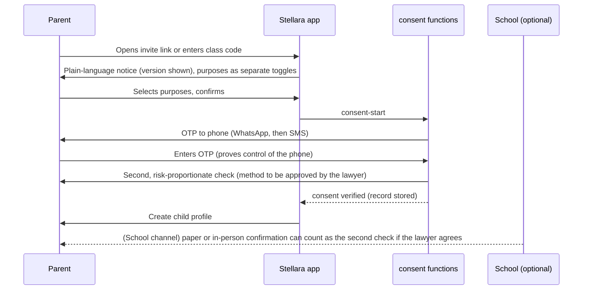

# 07 · Privacy, security and compliance

> **Not legal advice.** This document turns the audit's findings into build requirements. A Nigerian data-protection and IP lawyer must confirm the consent method, the transfer basis, the DPIA and all public wording before the pilot.

## 1. Obligations at a glance (Nigeria Data Protection Act 2023 and GAID 2025)

| Obligation | What we do | Owner | When |
|---|---|---|---|
| Lawful basis and consent for children (s.31) | Parent-led accounts; verified parental consent before any child data | Product, legal | Before the pilot |
| DPIA (s.28) | Signed DPIA covering scoring, the guardian view, gamification, analytics, hosting and transfer, messaging | DPO | Before the pilot |
| Data Protection Officer (s.32) | Appoint a DPO (can be external) | Founder | Before the pilot |
| Registration with the NDPC (s.44) | Register as a data controller of major importance if thresholds are met | DPO | Before public launch |
| Breach notification (s.40) | Notify the NDPC within 72 hours; tell parents without undue delay where risk is high | DPO, engineering | Runbook before the pilot |
| Cross-border transfer (s.41–43) | Document the basis for hosting outside Nigeria; disclose it in the notice | DPO, legal | Before the pilot |
| Data subject rights | Export, correction, deletion, withdrawal, all from Settings | Product | MVP |
| Processor contracts | Data processing agreements with Supabase, Vercel, the messaging provider, Sentry and Paystack; DPAs with schools | Legal | Before the pilot |

## 2. Data we collect

| Data | From | Purpose | Notes |
|---|---|---|---|
| Parent name, phone or email | Parent | Account, consent, reports | |
| Child first name, birth year, class, avatar choice | Parent | Learning, school link | **No photos, no surname required, no NIN or ID numbers** |
| Learning records (responses, timings, mastery) | System | Core learning, reports | |
| Teacher name, phone or email, school | School | Account, class management | |
| Device and technical data | System | Security, performance | IP addresses hashed in the audit log after 30 days |

We never collect from children: photos, voice, free text, location, contacts, or exam registration numbers.

## 3. Parental consent

The record holds: who consented, which child, the notice version, the purposes, the time, the method and evidence references. Withdrawal is two taps and stops processing immediately.

**Open:** which second check satisfies s.31(2) short of government ID. Candidate methods to put to the lawyer: confirmation through the school (the school already holds verified parent contacts); a small card payment by the parent (Phase 2); a signed school consent form uploaded by the school. We never collect a child's ID. If parent ID is ever used, we keep only the check result.

## 4. Roles and access

| Role | Can see |
|---|---|
| Child | Own sky, own sets and results |
| Guardian | Own children's full records |
| Teacher | Children in assigned classes: first name, avatar, mastery, sets. Not guardian contact details |
| School admin | Aggregates across the school, class lists, licence usage. Guardian contact details only for consenting parents and only the channel the school already holds |
| Content roles | Content only; no learner data |
| Ops | Learner data only through audited support tools, with a reason recorded |

## 5. Retention

| Data | Kept for | Then |
|---|---|---|
| Child profile and learning records | While the account is active, plus 12 months after the last activity or the end of the school licence | Deleted; aggregates anonymised |
| Consent records | 6 years after withdrawal or deletion (evidence) | Deleted |
| Audit log | 2 years | Deleted |
| Raw IP addresses | 30 days | Hashed |
| Messages log | 12 months | Deleted |
| Events (analytics) | 25 months | Aggregated |
| Backups | 30 days point-in-time | Rolled off |

## 6. Security controls

Target: **OWASP ASVS Level 2** for the web app and functions.

- **Data isolation:** RLS on every table, with tests for every policy ([10](10-qa-and-testing.md)).
- **Secrets:** Supabase service key only in Edge Functions; no secrets in the client; secrets rotated quarterly.
- **Auth:** OTP rate limits; MFA for staff; child PINs hashed with argon2id; child JWTs short-lived.
- **Answer keys:** never in online set or test payloads; offline packs assumed extractable, so their items are kept out of test pools.
- **Integrity:** append-only `attempts`, `stardust_ledger`, `audit_log`; idempotent submissions; suspicious timing flagged.
- **Transport and storage:** TLS 1.2+; encryption at rest (provider); signed URLs for exports, expiring in 24 h.
- **Dependencies:** Renovate, `pnpm audit` in CI, lockfile required.
- **Headers:** strict CSP, no third-party scripts on logged-in surfaces, `frame-ancestors 'none'`.
- **Logging:** no personal data in logs; Sentry PII scrubbing; request IDs.
- **Pen test:** an external test before the public launch.

## 7. Breach runbook (outline)

1. Detect and record (time, source, scope).
2. Contain (rotate keys, disable accounts, block routes).
3. Assess the risk to children and parents within 24 hours.
4. Notify the NDPC within 72 hours where required; notify parents and schools in plain language.
5. Fix, review, and update the DPIA and controls.

## 8. Claims, marketing and exam bodies

- No guaranteed results, predicted scores or "you are ready" in product or marketing.
- Exam names in plain text only, no logos, plus a non-affiliation line: *"Stellara is an independent learning service and is not affiliated with NECO or any examination body."*
- Never use "expo", "runz" or "live questions".
- Keep a claims register: every marketing claim with dated evidence. Check ARCON pre-vetting requirements before paid advertising.
- No advertising or third-party tracking on children's screens.

## 9. Children's rights by design

From UN General Comment 25 and the brand's own rules:

- No dark patterns: no loss-framed streaks, no countdown pressure beyond real exam timers, no purchases inside children's screens.
- Notifications at most once a day, never during quiet hours (20:00–07:00) or school hours by default.
- No social features, chat or public profiles for children in the MVP.
- No AI features for children until a DPIA update and DPO sign-off.
