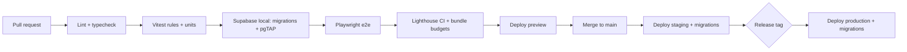

# 11 · DevOps and environments

## 1. Environments

| Environment | Supabase project | Web | Data | Who |
|---|---|---|---|---|
| Local | Supabase CLI (Docker) | `next dev` | Seed + fixtures | Engineers |
| Preview | Supabase branch per PR | Vercel preview | Seed only | Engineers, product |
| Staging | `stellara-staging` | `staging.<domain>` | Synthetic schools; no real children | QA, content, pilot schools for training |
| Production | `stellara-prod` | `app.<domain>` | Real | Everyone |

Real children's data never leaves production. Staging uses generated data only.

## 2. CI/CD (GitHub Actions)

The current foundation workflow runs on pushes and pull requests with Node 22,
one root pnpm lockfile and frozen installation. It enforces formatting, lint and
import boundaries, strict typechecks, rules/schema/docs tests, rules branch
coverage of at least 90%, a production web build, a client-bundle canary audit and
generated-output freshness. There is no deployment, database provisioning or
production-data access in this workflow. The diagram below describes later gates
once their respective application and database features exist.

Weekly-report adapters must use consecutive Sunday 18:00 Lagos snapshot periods,
matching the pure rules package, rather than a Monday-to-Monday period that has
not ended at dispatch time. Trusted pause tracking and the grace-period finalizer
must share the same effective test deadline.

- Migrations are applied by CI only (`supabase db push`), never by hand.
- Edge Functions deploy with the same release tag as the web app.
- Production deploys happen outside school hours (after 16:00 Lagos time) unless they are hotfixes.

## 3. Database operations

- Point-in-time recovery enabled; a restore is tested quarterly into a scratch project.
- `attempts` partitioned by month; partitions older than the retention window are purged by job ([07 §5](07-privacy-security-compliance.md#5-retention)).
- A read-only replica or reporting views for Metabase; Metabase never connects with the service role.

## 4. Secrets and config

- Secrets in GitHub Actions environments and Supabase function secrets. Never in the repo.
- Rotate the service key, provider keys and webhook secrets quarterly, and immediately after staff changes.
- `.env.example` documents every variable; values come from the secret store.

## 5. Monitoring and alerting

| Signal | Tool | Alert |
|---|---|---|
| Uptime of app and functions | Uptime monitor (1-minute checks from Africa and Europe) | 2 failed checks → on-call |
| Errors | Sentry | New issue in child runtime → Slack; error rate > 2% → on-call |
| Function latency | Supabase logs + dashboard | `responses-submit` p95 > 800 ms for 10 min |
| Sync backlog | `events.sync_completed.max_delay_s` | p95 > 6 h on a school day |
| Messaging | Provider dashboard + `messages.status` | Failure rate > 5% |
| Cost | Supabase, Vercel, messaging usage | Monthly budget at 80% |

When an outage exceeds 2 hours in a learning day, record it in `outages` so streaks are excused ([02 §7](02-learning-rules.md#7-days-in-a-row-and-resting-clouds)).

## 6. Incident response

1. Acknowledge within 15 minutes during school hours (07:00–17:00 Lagos), 1 hour otherwise.
2. Post a status note for schools (status page or WhatsApp broadcast).
3. Mitigate, then fix.
4. Write a blameless review within 5 working days.
5. Personal data involved? Follow the breach runbook in [07 §7](07-privacy-security-compliance.md#7-breach-runbook-outline).

## 7. Costs to watch

- Supabase compute tier, database size and egress.
- WhatsApp conversation fees per parent per month; prefer monthly summaries plus in-app weekly reports.
- SMS fallback costs and sender ID registration (register at least 3 weeks before the pilot).
- Vercel bandwidth (packs and media come from the CDN and Storage).
